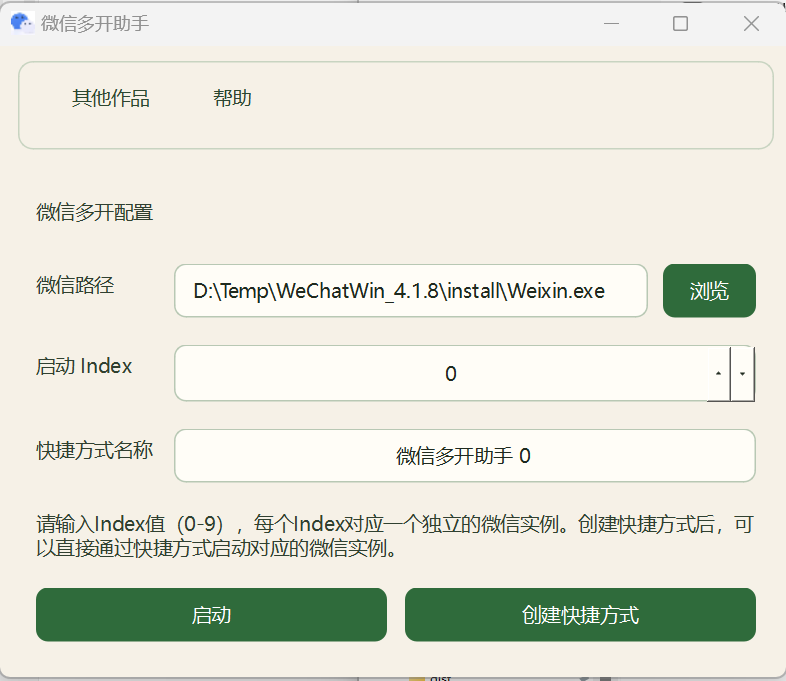

## 微信多开助手

可以支持多账号同时自动登录的微信多开助手，可通过配置偏移适配任意4.1以上版本。

目前已经支持的版本：

- `4.1.1.19`
- `4.1.8.101`

如果没有你需要的版本，你可以查看[如何查找偏移](./find_offset.md)来自己更新偏移，全程用时应该不会超过五分钟

#### 使用方法

打开软件，然后选择微信路径，创建快捷方式到桌面，后面就可以通过不同的快捷方式登录不同的账号，互相不影响。

#### 实现原理

首先启动微信并暂停微信，注入DLL修改内存中的互斥体名称和`global_config`字符串，hook创建互斥体函数，当微信创建互斥体完成后，恢复修改的内存字符串，移除掉hook。

这种方式应该比直接在dll上打补丁要安全一些，hook的时间很短几乎很难被检测到。

#### 感谢

- `https://github.com/zetaloop/BetterWX`