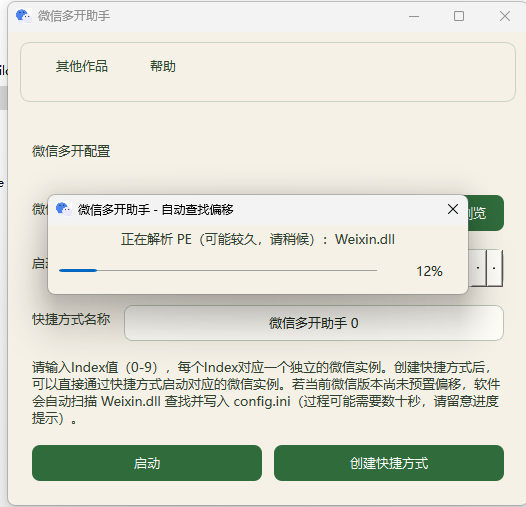
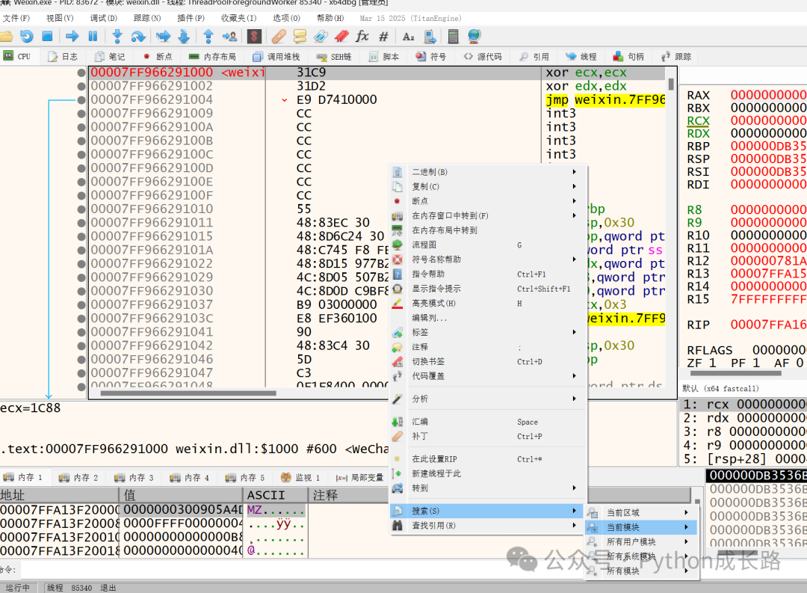
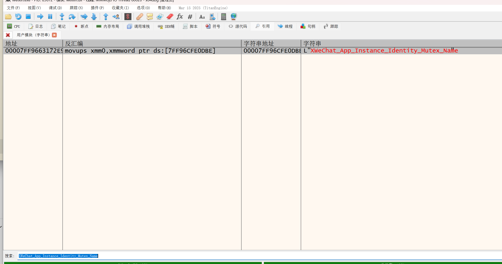
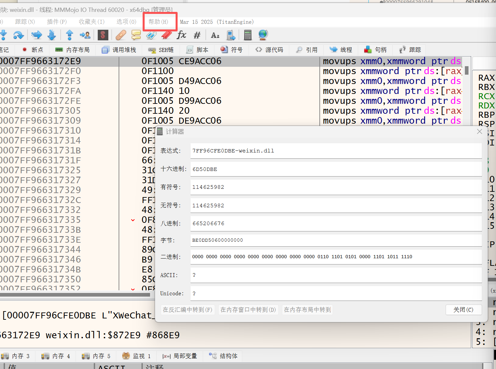
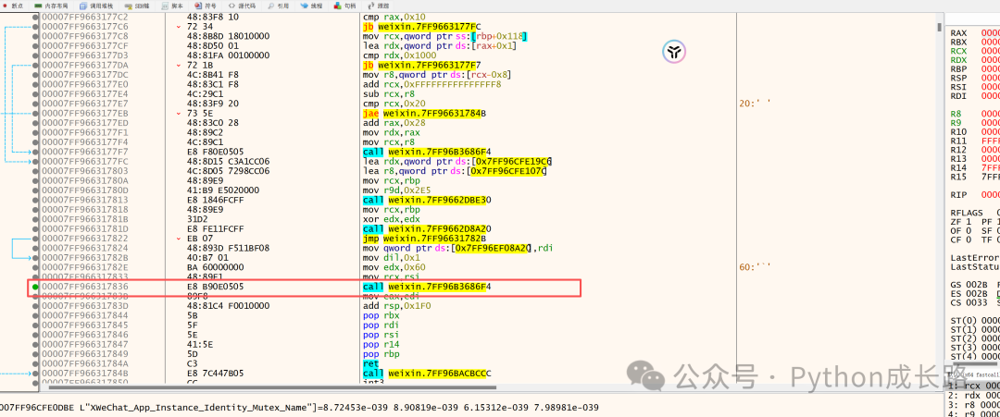
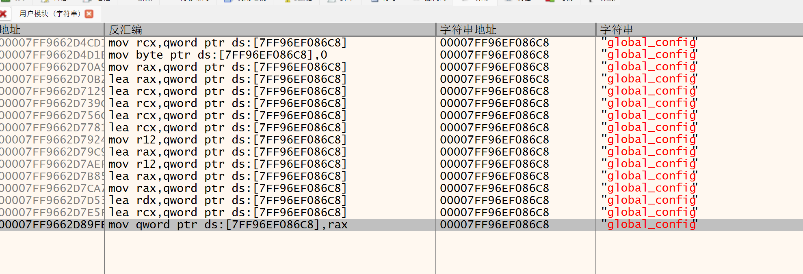
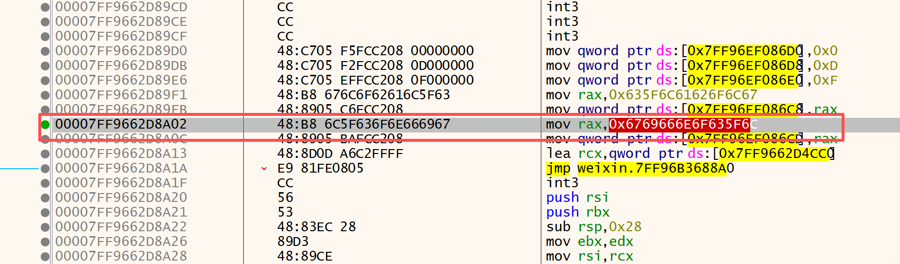
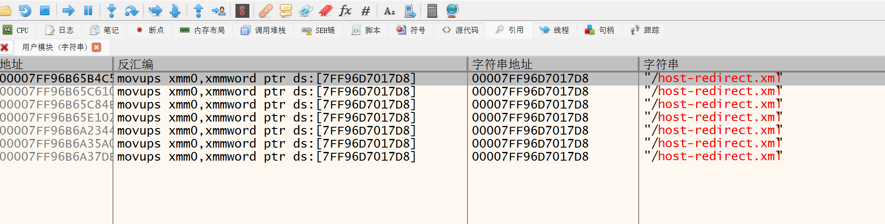
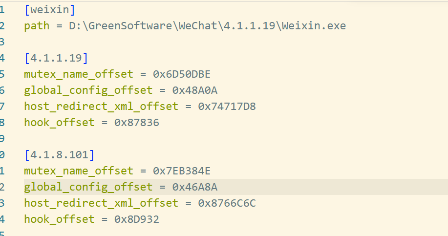

其实可以写一个工具来自动化查找偏移，不过手动查找也用不了什么时间，反而写这个工具得花费很多时间。

#### 准备工作

- 要适配的微信安装包
- x64dbg: `https://github.com/x64dbg/x64dbg`

#### 开始查找

先启动微信(不需要登录)，打开x64dbg选择菜单栏里的`文件`->`附加`选择刚才启动的微信

选择`符号`然后双击weixin.dll会跳转到CPU的界面

在CPU的界面右键`搜索`->`当前模块`->`字符串`，然后就会跳转到`引用`的界面

先搜索L`XWeChat_App_Instance_Identity_Mutex_Name`(宽字符串)，这个`7FF96CFE0DBE`就是这个字符串的地址，你可以双击跳转过去按空格就能复制出来。

点击菜单栏里的`帮助`->`计算器`，用这个地址减weixin.dll的地址得到的就是需要的偏移(mutex_name_offset)。

找到`XWeChat_App_Instance_Identity_Mutex_Name`这个字符串地址被引用的位置，然后从被引用的地址开始一直向下滑，直到看到第一个ret指令的地方，选择ret前面的第一个call所在的地址：00007FF966317836，将这个地址同样减去weixin.dll的就是hook_offset的偏移

然后搜索`global_config`，

这里选择最后一个，需要的地址是00007FF9662D8A02+8，+8是固定的(global_config_offset)。

最后一个搜索`host-redirect.xml`,7FF96D7017D8-weixin.dll就是需要的host_redirect_xml_offset，至此所有偏移都已经找到了。

更新到配置文件config.ini后重新打开软件就可以生效了
